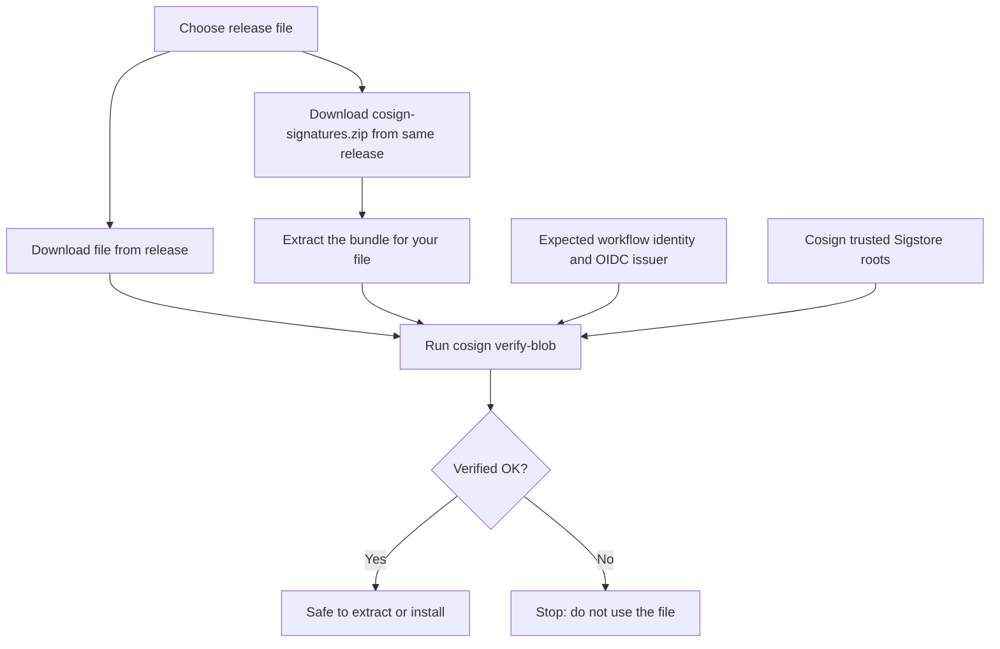

# Verify Console and RPC-Go Releases

Console and RPC-Go release files are signed with [Cosign](https://docs.sigstore.dev/cosign/signing/overview/) during the GitHub Actions release build. The signature lets you confirm that a file downloaded from a GitHub release is the file the project published and has not been changed. This page lists the signed files, the expected signing identities, and the `cosign verify-blob` commands used to check them.

!!! warning "Verify first"
    Verify a release file **before** you extract, install, or run it. If verification fails, do not use the file.

## What Verification Tells You

Console and RPC-Go use keyless signing. During the release build, GitHub Actions requests a short-lived certificate from Sigstore that names the exact workflow running the build. The signature, certificate, file digest, and transparency-log evidence are stored together in a **bundle** file that is published with the release.

When you run `cosign verify-blob`, Cosign checks that:

- The file you downloaded matches the digest in the bundle.
- The signature is valid and was recorded in the Sigstore transparency log.
- The certificate names the workflow identity **you expect** and was issued for GitHub Actions.

You supply the expected workflow identity yourself. Never take it from the bundle you are checking.

A successful check means the file matches its signature and was signed by the expected release workflow. It does not mean the software is free of bugs, or that the build workflow itself was never compromised.



### What Is and Is Not Signed

| Signed | Not signed |
|---|---|
| Linux and macOS `.tar.gz` archives (verify the archive **before** extracting) | `licenses.zip` |
| Windows `.exe` files | `cosign-signatures.zip` itself |
| RPC-Go shared library archive (`rpc_so_x64.tar.gz`) | Source archives and Docker images |

These are detached Cosign signatures. They are not Windows Authenticode signatures or Apple notarization, so Windows SmartScreen and macOS Gatekeeper behave the same with or without them.

## Prerequisites

- [Cosign](https://github.com/sigstore/cosign/releases/tag/v3.0.2) v3.0.2 or a newer v3 release. Older versions cannot read the bundle format.
- `unzip` (Linux and macOS). PowerShell includes `Expand-Archive` on Windows.
- A way to download the release file and signature archive from GitHub, and network access to the Sigstore public services.

On Windows, install Cosign from PowerShell with [WinGet](https://learn.microsoft.com/windows/package-manager/winget/):

```powershell
winget install --id Sigstore.Cosign --exact
```

The WinGet Cosign package exposes the command as `cosign-windows-amd64`. If a command is not recognized after installation, open a new PowerShell window and try again.

If your network requires an HTTP proxy, set the proxy URLs provided by your network administrator before running Cosign. These variables apply to commands started from the current shell.

On Linux or macOS, export them in Bash or zsh:

```bash
export HTTP_PROXY='http://proxy.example:port'
export HTTPS_PROXY='http://proxy.example:port'
```

On Windows, set them in PowerShell:

```powershell
$env:HTTP_PROXY = 'http://proxy.example:port'
$env:HTTPS_PROXY = 'http://proxy.example:port'
```

## Release Reference

The commands in this guide use the following releases as examples. To verify a different release, change the tag, file, and bundle names. Confirm the signing identity as described in [Verify a Different Release](#verify-a-different-release).

| | Console | RPC-Go 2.x | RPC-Go 3.x (beta) |
|---|---|---|---|
| Repository | `device-management-toolkit/console` | `device-management-toolkit/rpc-go` | `device-management-toolkit/rpc-go` |
| Example tag | `v1.47.0` | `v2.52.8` | `v3.0.0-beta.75` |
| Signing branch for the example | `main` | `2.x.x` | `main` |
| Signature archive | `cosign-signatures.zip` | `cosign-signatures.zip` | `cosign-signatures.zip` |
| Bundle file suffix | `.cosign.bundle.json` | `.sigstore.json` | `.sigstore.json` |

RPC-Go 3.x releases are published as pre-releases (`-beta.N` tags) from the `main` branch, while RPC-Go 2.x releases are built from the `2.x.x` branch. The signed file names and bundle names are the same for both lines.

**Expected certificate identities:**

| Release | Identity (`--certificate-identity`) |
|---|---|
| Console | `https://github.com/device-management-toolkit/console/.github/workflows/release.yml@refs/heads/main` |
| RPC-Go 2.x | `https://github.com/device-management-toolkit/rpc-go/.github/workflows/release.yml@refs/heads/2.x.x` |
| RPC-Go 3.x | `https://github.com/device-management-toolkit/rpc-go/.github/workflows/release.yml@refs/heads/main` |

**OIDC issuer (`--certificate-oidc-issuer`)** for both: `https://token.actions.githubusercontent.com`

### Release Files and Their Bundles

Use the bundle listed for your file. The RPC-Go rows apply to both 2.x and 3.x beta releases.

| Release file | Bundle inside `cosign-signatures.zip` |
|---|---|
| Console `console_linux_x64.tar.gz` | `console_linux_x64.tar.gz.cosign.bundle.json` |
| Console `console_linux_x64_headless.tar.gz` | `console_linux_x64_headless.tar.gz.cosign.bundle.json` |
| Console `console_linux_arm64.tar.gz` | `console_linux_arm64.tar.gz.cosign.bundle.json` |
| Console `console_linux_arm64_headless.tar.gz` | `console_linux_arm64_headless.tar.gz.cosign.bundle.json` |
| Console `console_mac_arm64.tar.gz` | `console_mac_arm64.tar.gz.cosign.bundle.json` |
| Console `console_mac_arm64_headless.tar.gz` | `console_mac_arm64_headless.tar.gz.cosign.bundle.json` |
| Console `console_windows_x64.exe` | `dist%2Fwindows%2Fconsole_windows_x64.exe.cosign.bundle.json` |
| Console `console_windows_x64_headless.exe` | `dist%2Fwindows%2Fconsole_windows_x64_headless.exe.cosign.bundle.json` |
| RPC-Go `rpc_linux_x64.tar.gz` | `rpc_linux_x64.tar.gz.sigstore.json` |
| RPC-Go `rpc_linux_x86.tar.gz` | `rpc_linux_x86.tar.gz.sigstore.json` |
| RPC-Go `rpc_windows_x64.exe` | `rpc_windows_x64.exe.sigstore.json` |
| RPC-Go `rpc_windows_x86.exe` | `rpc_windows_x86.exe.sigstore.json` |
| RPC-Go `rpc_so_x64.tar.gz` | `rpc_so_x64.tar.gz.sigstore.json` |

!!! note
    The `%2F` characters in the Console Windows bundle names are part of the actual file name. Do not decode them. RPC-Go v2.52.8 and v3.0.0-beta.75 have no macOS release file, and their Windows ZIPs are not signed.

## Download Release Files

From the release page for the repository and tag you want to verify, download the release file and `cosign-signatures.zip` into the same directory. Make sure both downloads are from the same release. The platform-specific commands below extract the bundle for the selected file, as listed in the table above.

## Verify on Linux or macOS

1. Set the variables for the release file you downloaded in your terminal (Bash or zsh).

    === "Console (Linux x64)"

        ```bash
        ARTIFACT='console_linux_x64.tar.gz'
        BUNDLE='console_linux_x64.tar.gz.cosign.bundle.json'
        IDENTITY='https://github.com/device-management-toolkit/console/.github/workflows/release.yml@refs/heads/main'
        ```

    === "RPC-Go 3.x beta (Linux x64)"

        ```bash
        ARTIFACT='rpc_linux_x64.tar.gz'
        BUNDLE='rpc_linux_x64.tar.gz.sigstore.json'
        IDENTITY='https://github.com/device-management-toolkit/rpc-go/.github/workflows/release.yml@refs/heads/main'
        ```

    === "RPC-Go 2.x (Linux x64)"

        ```bash
        ARTIFACT='rpc_linux_x64.tar.gz'
        BUNDLE='rpc_linux_x64.tar.gz.sigstore.json'
        IDENTITY='https://github.com/device-management-toolkit/rpc-go/.github/workflows/release.yml@refs/heads/2.x.x'
        ```

2. From the directory containing the downloaded files, extract the selected bundle and verify the release file:

    ```bash
    mkdir -p signatures
    unzip -q cosign-signatures.zip "$BUNDLE" -d signatures
    if cosign verify-blob \
        --bundle "signatures/$BUNDLE" \
        --certificate-identity "$IDENTITY" \
        --certificate-oidc-issuer 'https://token.actions.githubusercontent.com' \
        "$ARTIFACT"; then
        printf 'Cosign verification succeeded.\n'
    else
        printf 'Verification failed; do not use the file.\n' >&2
        false
    fi
    ```

3. On success, Cosign prints `Verified OK`, followed by the confirmation message. On failure, the block prints an error and returns a nonzero status without closing the shell. Do not use the file; go to [If Verification Fails](#if-verification-fails).

## Verify on Windows

1. In PowerShell, set the variables for the release file you downloaded.

    === "Console (Windows x64)"

        ```powershell
        $Artifact = 'console_windows_x64.exe'
        $Bundle = 'dist%2Fwindows%2Fconsole_windows_x64.exe.cosign.bundle.json'
        $Identity = 'https://github.com/device-management-toolkit/console/.github/workflows/release.yml@refs/heads/main'
        ```

    === "RPC-Go 3.x beta (Windows x64)"

        ```powershell
        $Artifact = 'rpc_windows_x64.exe'
        $Bundle = 'rpc_windows_x64.exe.sigstore.json'
        $Identity = 'https://github.com/device-management-toolkit/rpc-go/.github/workflows/release.yml@refs/heads/main'
        ```

    === "RPC-Go 2.x (Windows x64)"

        ```powershell
        $Artifact = 'rpc_windows_x64.exe'
        $Bundle = 'rpc_windows_x64.exe.sigstore.json'
        $Identity = 'https://github.com/device-management-toolkit/rpc-go/.github/workflows/release.yml@refs/heads/2.x.x'
        ```

2. From the directory containing the downloaded files, extract the signature archive and verify the release file:

    ```powershell
    $ErrorActionPreference = 'Stop'
    $Cosign = 'cosign'
    if (-not (Get-Command $Cosign -ErrorAction SilentlyContinue)) {
        $Cosign = 'cosign-windows-amd64'
    }
    if (-not (Get-Command $Cosign -ErrorAction SilentlyContinue)) {
        throw 'Cosign was not found. Install Cosign v3.0.2 or newer in the v3 series.'
    }
    Expand-Archive -LiteralPath '.\cosign-signatures.zip' -DestinationPath '.\signatures' -Force
    $BundlePath = Join-Path '.\signatures' $Bundle
    if (-not (Test-Path -LiteralPath $BundlePath)) { throw "Bundle not found: $BundlePath" }
    & $Cosign verify-blob `
        --bundle $BundlePath `
        --certificate-identity $Identity `
        --certificate-oidc-issuer 'https://token.actions.githubusercontent.com' `
        $Artifact
    if ($LASTEXITCODE -ne 0) { throw 'Verification failed; do not use the file' }
    Write-Host 'Cosign verification succeeded.'
    ```

3. On success, Cosign prints `Verified OK`, followed by the confirmation message. On failure, the script stops with an error. Do not use the file; go to [If Verification Fails](#if-verification-fails).

For another Windows variant, change both the file and bundle names using the [table above](#release-files-and-their-bundles).

## Verify a Different Release

The signing branch can differ between releases, so do not reuse an example identity for another tag without checking it. To confirm the identity for a tag:

1. Open `.github/workflows/release.yml` in the repository at that tag.
2. Confirm the branch the release was built from.
3. Build the identity as `https://github.com/<owner>/<repo>/.github/workflows/release.yml@refs/heads/<branch>`.

If you are unsure, ask the maintainers by opening an issue in the repository or asking on [Discord](https://discord.gg/yrcMp2kDWh). Never accept an identity just because it appears in the bundle.

## If Verification Fails

| Symptom | What to do |
|---|---|
| Bundle file not found | List the contents of `cosign-signatures.zip` and check the file-to-bundle table. |
| Signature or digest does not match | Confirm the project, tag, platform, and variant of the file. Download both the file and the signature archive again from the same release. |
| Certificate identity mismatch | Stop. Independently confirm the expected repository, workflow, and branch. Do not loosen the identity check. |
| Unsupported bundle or unknown option | Upgrade to Cosign v3.0.2 or a newer v3 release. |
| HTTP 502, 503, or 504 while downloading a release file | Retry later or check your network or proxy. Do not use an incomplete file; make sure the release file and bundle came from the same release. |
| Sigstore network or trust-root error | Check your network and proxy settings, and that Cosign can reach the Sigstore public services. This is a setup problem, not evidence of tampering. |

Do not bypass the transparency-log or identity checks to force a pass. The signature archive alone is not enough to establish trust offline, because Cosign needs the Sigstore trusted roots to evaluate it.

## Related Resources

- [Cosign verification documentation](https://docs.sigstore.dev/cosign/verifying/verify/)
