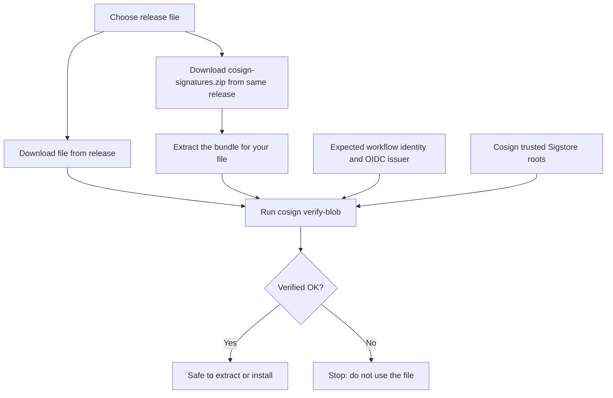

# Verify Console and RPC-Go Releases

Learn how to check that a Console or RPC-Go release file you downloaded from GitHub is the file the project published. Each release is signed with [Cosign](https://docs.sigstore.dev/cosign/signing/overview/) during the GitHub Actions release build. You verify the signature with `cosign verify-blob` before you extract, install, or run the file.

!!! warning "Verify first"
    Verify a release file **before** you extract, install, or run it. If verification fails, do not use the file.

## What Verification Tells You

Console and RPC-Go use keyless signing. During the release build, GitHub Actions requests a short-lived certificate from Sigstore that names the exact workflow running the build. The signature, certificate, file digest, and transparency-log evidence are stored together in a **bundle** file that is published with the release.

When you run `cosign verify-blob`, Cosign checks that:

- The file you downloaded matches the digest in the bundle.
- The signature is valid and was recorded in the Sigstore transparency log.
- The certificate names the workflow identity **you expect** and was issued for GitHub Actions.

You supply the expected workflow identity yourself. Never take it from the bundle you are checking.

A successful check means the file matches its signature and was signed by the expected release workflow. It does not mean the software is free of bugs, or that the build workflow itself was never compromised.



### What Is and Is Not Signed

| Signed | Not signed |
|---|---|
| Linux and macOS `.tar.gz` archives (verify the archive **before** extracting) | `licenses.zip` |
| Windows `.exe` files | `cosign-signatures.zip` itself |
| RPC-Go shared library archive (`rpc_so_x64.tar.gz`) | Source archives and Docker images |

These are detached Cosign signatures. They are not Windows Authenticode signatures or Apple notarization, so Windows SmartScreen and macOS Gatekeeper behave the same with or without them.

## Prerequisites

- [Cosign](https://github.com/sigstore/cosign/releases/tag/v3.0.2) v3.0.2 or a newer v3 release. Older versions cannot read the bundle format.
- [GitHub CLI](https://cli.github.com/) (`gh`), signed in with `gh auth login`. You can instead download the files in your browser from the release page and skip `gh`.
- `unzip` (Linux and macOS). PowerShell includes `Expand-Archive` on Windows.
- Network access to GitHub and the Sigstore public services.

## Release Reference

The commands in this guide use the following releases as examples. To verify a different release, change the tag, file, and bundle names. Confirm the signing identity as described in [Verify a Different Release](#verify-a-different-release).

| | Console | RPC-Go 2.x | RPC-Go 3.x (beta) |
|---|---|---|---|
| Repository | `device-management-toolkit/console` | `device-management-toolkit/rpc-go` | `device-management-toolkit/rpc-go` |
| Example tag | `v1.47.0` | `v2.52.8` | `v3.0.0-beta.75` |
| Signing branch for the example | `main` | `2.x.x` | `main` |
| Signature archive | `cosign-signatures.zip` | `cosign-signatures.zip` | `cosign-signatures.zip` |
| Bundle file suffix | `.cosign.bundle.json` | `.sigstore.json` | `.sigstore.json` |

RPC-Go 3.x releases are published as pre-releases (`-beta.N` tags) from the `main` branch, while RPC-Go 2.x releases are built from the `2.x.x` branch. The signed file names and bundle names are the same for both lines.

**Expected certificate identities:**

| Release | Identity (`--certificate-identity`) |
|---|---|
| Console v1.47.0 | `https://github.com/device-management-toolkit/console/.github/workflows/release.yml@refs/heads/main` |
| RPC-Go v2.52.8 | `https://github.com/device-management-toolkit/rpc-go/.github/workflows/release.yml@refs/heads/2.x.x` |
| RPC-Go v3.0.0-beta.75 | `https://github.com/device-management-toolkit/rpc-go/.github/workflows/release.yml@refs/heads/main` |

**OIDC issuer (`--certificate-oidc-issuer`)** for both: `https://token.actions.githubusercontent.com`

### Release Files and Their Bundles

Download `cosign-signatures.zip` and your release file from the **same** release, then extract the ZIP. Use the bundle listed for your file. The RPC-Go rows apply to both 2.x and 3.x beta releases.

| Release file | Bundle inside `cosign-signatures.zip` |
|---|---|
| Console `console_linux_x64.tar.gz` | `console_linux_x64.tar.gz.cosign.bundle.json` |
| Console `console_linux_x64_headless.tar.gz` | `console_linux_x64_headless.tar.gz.cosign.bundle.json` |
| Console `console_linux_arm64.tar.gz` | `console_linux_arm64.tar.gz.cosign.bundle.json` |
| Console `console_linux_arm64_headless.tar.gz` | `console_linux_arm64_headless.tar.gz.cosign.bundle.json` |
| Console `console_mac_arm64.tar.gz` | `console_mac_arm64.tar.gz.cosign.bundle.json` |
| Console `console_mac_arm64_headless.tar.gz` | `console_mac_arm64_headless.tar.gz.cosign.bundle.json` |
| Console `console_windows_x64.exe` | `dist%2Fwindows%2Fconsole_windows_x64.exe.cosign.bundle.json` |
| Console `console_windows_x64_headless.exe` | `dist%2Fwindows%2Fconsole_windows_x64_headless.exe.cosign.bundle.json` |
| RPC-Go `rpc_linux_x64.tar.gz` | `rpc_linux_x64.tar.gz.sigstore.json` |
| RPC-Go `rpc_linux_x86.tar.gz` | `rpc_linux_x86.tar.gz.sigstore.json` |
| RPC-Go `rpc_windows_x64.exe` | `rpc_windows_x64.exe.sigstore.json` |
| RPC-Go `rpc_windows_x86.exe` | `rpc_windows_x86.exe.sigstore.json` |
| RPC-Go `rpc_so_x64.tar.gz` | `rpc_so_x64.tar.gz.sigstore.json` |

!!! note
    The `%2F` characters in the Console Windows bundle names are part of the actual file name. Do not decode them. RPC-Go v2.52.8 and v3.0.0-beta.75 have no macOS release file, and their Windows ZIPs are not signed.

## Verify on Linux or macOS

1. Set the variables for the release you want to verify in your terminal (Bash or zsh).

    === "Console (Linux x64 headless)"

        ```bash
        REPO='device-management-toolkit/console'
        TAG='v1.47.0'
        ARTIFACT='console_linux_x64_headless.tar.gz'
        BUNDLE='console_linux_x64_headless.tar.gz.cosign.bundle.json'
        IDENTITY='https://github.com/device-management-toolkit/console/.github/workflows/release.yml@refs/heads/main'
        ```

    === "RPC-Go 3.x beta (Linux x64)"

        ```bash
        REPO='device-management-toolkit/rpc-go'
        TAG='v3.0.0-beta.75'
        ARTIFACT='rpc_linux_x64.tar.gz'
        BUNDLE='rpc_linux_x64.tar.gz.sigstore.json'
        IDENTITY='https://github.com/device-management-toolkit/rpc-go/.github/workflows/release.yml@refs/heads/main'
        ```

    === "RPC-Go 2.x (Linux x64)"

        ```bash
        REPO='device-management-toolkit/rpc-go'
        TAG='v2.52.8'
        ARTIFACT='rpc_linux_x64.tar.gz'
        BUNDLE='rpc_linux_x64.tar.gz.sigstore.json'
        IDENTITY='https://github.com/device-management-toolkit/rpc-go/.github/workflows/release.yml@refs/heads/2.x.x'
        ```

2. In the same terminal, run the following block. It downloads the files into a new temporary directory, extracts the signatures, and verifies the file. It does not change your current directory.

    ```bash
    verify_release() (
      if [[ -z "${REPO:-}" || -z "${TAG:-}" || -z "${ARTIFACT:-}" ||
            -z "${BUNDLE:-}" || -z "${IDENTITY:-}" ]]; then
        printf 'Set the release variables in this terminal first.\n' >&2
        return 1
      fi

      ISSUER='https://token.actions.githubusercontent.com'
      DESTINATION=$(mktemp -d) || return 1
      cd "$DESTINATION" || return 1

      gh release download "$TAG" --repo "$REPO" \
        --pattern "$ARTIFACT" --pattern 'cosign-signatures.zip' || return 1
      unzip -q cosign-signatures.zip -d signatures || return 1

      cosign verify-blob \
        --bundle "signatures/$BUNDLE" \
        --certificate-identity "$IDENTITY" \
        --certificate-oidc-issuer "$ISSUER" \
        "$ARTIFACT" || return 1
      printf 'Verified. Files are in %s\n' "$DESTINATION"
    )

    if ! verify_release; then
      printf 'Verification failed; review the error above.\n' >&2
    fi
    ```

3. Check the result.

    - **Success:** Cosign prints `Verified OK`, then the script prints the directory that holds the verified files.
    - **Failure:** The script prints `Verification failed` after the error from the failing step. Do not use the file. Go to [If Verification Fails](#if-verification-fails).

4. After verification succeeds, list the archive contents and extract into an empty directory. This example uses the RPC-Go Linux x64 archive.

    ```bash
    tar -tzf rpc_linux_x64.tar.gz
    mkdir extracted
    tar -xzf rpc_linux_x64.tar.gz -C extracted
    ```

    Console archives contain binaries under `dist/linux/` or `dist/darwin/`. RPC-Go Linux archives contain `rpc_linux_x64` or `rpc_linux_x86`. The RPC-Go shared library archive contains `rpc.so.<version>`, for example `rpc.so.2.52.8` or `rpc.so.3.0.0-beta.75`. Verification never requires you to run the executable or load the library.

## Verify on Windows

1. In PowerShell, set the variables for the release you want to verify.

    === "Console (Windows x64)"

        ```powershell
        $Repo = 'device-management-toolkit/console'
        $Tag = 'v1.47.0'
        $Artifact = 'console_windows_x64.exe'
        $Bundle = 'dist%2Fwindows%2Fconsole_windows_x64.exe.cosign.bundle.json'
        $Identity = 'https://github.com/device-management-toolkit/console/.github/workflows/release.yml@refs/heads/main'
        ```

    === "RPC-Go 3.x beta (Windows x64)"

        ```powershell
        $Repo = 'device-management-toolkit/rpc-go'
        $Tag = 'v3.0.0-beta.75'
        $Artifact = 'rpc_windows_x64.exe'
        $Bundle = 'rpc_windows_x64.exe.sigstore.json'
        $Identity = 'https://github.com/device-management-toolkit/rpc-go/.github/workflows/release.yml@refs/heads/main'
        ```

    === "RPC-Go 2.x (Windows x64)"

        ```powershell
        $Repo = 'device-management-toolkit/rpc-go'
        $Tag = 'v2.52.8'
        $Artifact = 'rpc_windows_x64.exe'
        $Bundle = 'rpc_windows_x64.exe.sigstore.json'
        $Identity = 'https://github.com/device-management-toolkit/rpc-go/.github/workflows/release.yml@refs/heads/2.x.x'
        ```

2. Download the files, extract the signatures, and verify.

    ```powershell
    $ErrorActionPreference = 'Stop'
    $Destination = Join-Path $HOME ("release-verification-" + [guid]::NewGuid())
    New-Item -ItemType Directory -Path $Destination | Out-Null
    Push-Location $Destination
    try {
      gh release download $Tag --repo $Repo `
        --pattern $Artifact --pattern 'cosign-signatures.zip'
      if ($LASTEXITCODE -ne 0) { throw 'Release download failed' }

      Expand-Archive '.\cosign-signatures.zip' '.\signatures'
      cosign verify-blob `
        --bundle (Join-Path '.\signatures' $Bundle) `
        --certificate-identity $Identity `
        --certificate-oidc-issuer 'https://token.actions.githubusercontent.com' `
        $Artifact
      if ($LASTEXITCODE -ne 0) { throw 'Verification failed; do not use the file' }
      Write-Host "Verified. Files are in $Destination"
    }
    finally {
      Pop-Location
    }
    ```

3. On success, Cosign prints `Verified OK` and the script prints the directory that holds the verified file. On failure, the script stops with an error. Do not use the file.

For another Windows variant, change both the file and bundle names using the [table above](#release-files-and-their-bundles).

## Verify a Different Release

The signing branch can differ between releases, so do not reuse an example identity for another tag without checking it. To confirm the identity for a tag:

1. Open `.github/workflows/release.yml` in the repository at that tag.
2. Confirm the branch the release was built from.
3. Build the identity as `https://github.com/<owner>/<repo>/.github/workflows/release.yml@refs/heads/<branch>`.

If you are unsure, ask the maintainers by opening an issue in the repository or asking on [Discord](https://discord.gg/yrcMp2kDWh). Never accept an identity just because it appears in the bundle.

## If Verification Fails

| Symptom | What to do |
|---|---|
| Bundle file not found | List the contents of `cosign-signatures.zip` and check the file-to-bundle table. |
| Signature or digest does not match | Confirm the project, tag, platform, and variant of the file. Download both the file and the signature archive again from the same release. |
| Certificate identity mismatch | Stop. Independently confirm the expected repository, workflow, and branch. Do not loosen the identity check. |
| Unsupported bundle or unknown option | Upgrade to Cosign v3.0.2 or a newer v3 release. |
| Network or trust-root error | Check your network and proxy settings, and that Cosign can reach the Sigstore public services. This is a setup problem, not evidence of tampering. |

Do not bypass the transparency-log or identity checks to force a pass. The signature archive alone is not enough to establish trust offline, because Cosign needs the Sigstore trusted roots to evaluate it.

## Related Resources

- [Cosign verification documentation](https://docs.sigstore.dev/cosign/verifying/verify/)
- [Console v1.47.0 release](https://github.com/device-management-toolkit/console/releases/tag/v1.47.0) and [signing script](https://github.com/device-management-toolkit/console/blob/v1.47.0/sign.sh)
- [RPC-Go v2.52.8 release](https://github.com/device-management-toolkit/rpc-go/releases/tag/v2.52.8) and [signing script](https://github.com/device-management-toolkit/rpc-go/blob/v2.52.8/sign.sh)
- [RPC-Go v3.0.0-beta.75 release](https://github.com/device-management-toolkit/rpc-go/releases/tag/v3.0.0-beta.75) and [signing script](https://github.com/device-management-toolkit/rpc-go/blob/v3.0.0-beta.75/sign.sh)