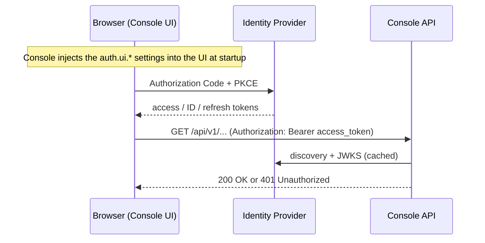

By default, Console signs users in with a single local admin account (`auth.adminUsername` / `auth.adminPassword`). For production deployments, connect Console to your own OAuth 2.0 / OpenID Connect (OIDC) identity provider (IdP) instead. Examples include Microsoft Entra ID, Amazon Cognito, Keycloak, Okta, Auth0 and Ping.

This tutorial walks through registering Console with an IdP, configuring Console, and verifying the result.

## How It Works

Console has two authentication modes. **Setting `auth.clientId` switches Console from basic auth to OAuth/OIDC.**

| | Basic Auth (default) | OAuth / OIDC |
|---|---|---|
| **Trigger** | `auth.clientId` empty | `auth.clientId` set |
| **Who signs the user in** | Console (`POST /api/v1/authorize`) | Your IdP (Authorization Code + PKCE, in the browser) |
| **Token sent to the API** | HS256 JWT signed with `auth.jwtKey` | The IdP **access token** (`Authorization: Bearer ...`) |
| **How Console validates it** | HMAC with `auth.jwtKey` | OIDC discovery on `auth.issuer`, JWKS signature check, `iss` check, `aud` must contain `auth.clientId`, `exp` check |
| **Session cookie** | Optional (`auth.cookieEnabled`) | Always off. Bearer header only. |



Two groups of settings are involved:

- **`auth.clientId` / `auth.issuer`** (the API side). Console uses these to **validate** tokens.
- **`auth.ui.*`** (the browser side). At startup Console writes these into the embedded UI so that it can **obtain** tokens. They only take effect when `auth.clientId` is also set.

## Prerequisites

- Console runs with HTTPS (`http.tls.enabled: true`, either with your own certificate or the generated self signed one). See [TLS Configuration](../../Reference/Console/tlsConfiguration.md). Most IdPs refuse non HTTPS redirect URIs except `localhost`.
- At startup, the Console host can reach `<issuer>/.well-known/openid-configuration` and the JWKS URL it points to.
- You know the exact public URL users will open, for example `https://console.example.com:8181/`.

!!! warning "Warning - IdP Reachability at Startup"
    Console runs OIDC discovery against `auth.issuer` when it starts. If the issuer cannot be reached, the login routes cannot be created and Console fails to start. Check DNS, proxy and certificate trust before you switch to OAuth.

## Token Requirements

Console checks the **access token** the UI sends, using an OIDC ID token verifier. The access token must:

1. Be a **JWT** signed with an asymmetric algorithm the IdP advertises in `id_token_signing_alg_values_supported` in its discovery document, for example RS256, ES256 or PS256 (RS256 if the IdP advertises none). Opaque tokens and HS256 tokens are rejected.
2. Have `iss` **exactly equal** to `auth.issuer`, including any trailing slash.
3. Have `aud` that **contains `auth.clientId`**.
4. Not be expired.

Most setup problems come from rule 3. The provider steps below cover it.

## Register Console with Your Identity Provider

Create **one public client** (a single page application with no client secret) that uses:

| Setting | Value |
|---|---|
| Grant type | Authorization Code with PKCE |
| Redirect URI | The Console UI URL, e.g. `https://console.example.com:8181/`. Must match `auth.ui.redirectUri` exactly. |
| Sign out redirect / Web origin | Same origin, e.g. `https://console.example.com:8181` |
| Scopes | `openid profile`, plus your API scope if your IdP requires one |

=== "Microsoft Entra ID"

    1. Go to **App registrations** and select **New registration**. Choose a single tenant. Under **Redirect URI**, pick **Single-page application** and enter `https://console.example.com:8181/`.
    2. In **Expose an API**, set the Application ID URI (the default is `api://<client-id>`) and add a scope such as `console.access`.
    3. In the **Manifest**, set `"requestedAccessTokenVersion": 2` (in older manifests the key is `accessTokenAcceptedVersion`). With v2 tokens, `iss` is `https://login.microsoftonline.com/<tenant-id>/v2.0` and `aud` is the client ID GUID, which is exactly what Console checks. With v1 tokens, `iss` is `https://sts.windows.net/<tenant-id>/` and validation fails.
    4. Use these values in the Console configuration:

        | Setting | Value |
        |---|---|
        | `clientId`, `ui.clientId` | Application (client) ID |
        | `issuer`, `ui.issuer` | `https://login.microsoftonline.com/<tenant-id>/v2.0` |
        | `ui.scope` | `openid profile api://<client-id>/console.access` |
        | `ui.strictDiscoveryDocumentValidation` | `false` (`AUTH_UI_STRICT_DISCOVERY=false`). Entra's endpoints (`.../<tenant-id>/oauth2/v2.0/...`, `.../discovery/v2.0/keys`) do not start with the issuer URL (`.../<tenant-id>/v2.0`), so strict validation in the UI rejects the discovery document. |

    !!! note "Note - Graph Scopes"
        Do not request only Microsoft Graph scopes such as `User.Read`. Entra would issue a Graph token (`aud` = Graph) that Console cannot validate.

=== "Amazon Cognito"

    **Cognito access tokens do not carry an `aud` claim.** They carry `client_id` instead, so Console rejects them by default. Add `aud` with a **Pre token generation Lambda trigger** that uses event version **V2_0**. AWS only allows that `aud` value to be the app client ID of the current session.

    !!! important "Important - Cognito Feature Plan"
        Access token customization (trigger event V2_0 / V3_0) requires the user pool to be on the **Essentials** or **Plus** feature plan. The Lite plan only supports V1_0, which customizes ID tokens only.

    1. Create a user pool, or use an existing one. Note the **Region** and **User pool ID** (e.g. `us-east-1_AbCdEf123`).
    2. Under **Branding > Domain**, configure a Cognito domain (`https://<prefix>.auth.<region>.amazoncognito.com`) or a custom domain for the managed login pages.
    3. Create an app client of type **Single-page application (SPA)**, which is a public client with **no client secret**:
        - Allowed callback URL: `https://console.example.com:8181/`
        - Allowed sign-out URL: `https://console.example.com:8181/`
        - OAuth grant type: **Authorization code grant**
        - OpenID Connect scopes: `openid`, `profile`, `email`
        - Access token expiration sets how long a UI session lasts (default 60 minutes)
    4. Create a Lambda function that adds `aud` to the access token (Node.js shown):

        ```js
        // Adds aud = app client ID so the Console OIDC verifier accepts the access token.
        export const handler = async (event) => {
          event.response = {
            claimsAndScopeOverrideDetails: {
              accessTokenGeneration: {
                claimsToAddOrOverride: { aud: event.callerContext.clientId }
              }
            }
          };
          return event;
        };
        ```

    5. In the user pool, go to **Extensions > Add Lambda trigger > Authentication > Pre token generation trigger**. Set **Trigger event version** to **Basic features + access token customization for user identities** (V2_0) and select the function. With the AWS CLI, set `LambdaConfig.PreTokenGenerationConfig` with `"LambdaVersion": "V2_0"`.
    6. Use these values in the Console configuration:

        | Setting | Value |
        |---|---|
        | `clientId`, `ui.clientId` | The app client ID. Both **must be the same** value, because Cognito only lets `aud` equal the session's app client ID. |
        | `issuer`, `ui.issuer` | `https://cognito-idp.<region>.amazonaws.com/<user-pool-id>` (no trailing slash) |
        | `ui.scope` | `openid profile email` |
        | `ui.strictDiscoveryDocumentValidation` | `false` (`AUTH_UI_STRICT_DISCOVERY=false`). Cognito lists its authorize and token endpoints on the `amazoncognito.com` (or custom) domain, so they do not start with the `cognito-idp` issuer URL and strict validation in the UI rejects the discovery document. |

    To check the setup, sign in, copy the access token from the browser network tab and decode it. You should see `iss: https://cognito-idp.<region>.amazonaws.com/<pool-id>`, `aud: <app client id>`, `token_use: access` and `alg: RS256`.

    !!! note "Note - Cognito Limitations"
        - **Machine-to-machine clients:** a client credentials token can only get `aud` from a **V3_0** trigger, and its `aud` would be the M2M client's own ID. Console accepts a single `auth.clientId`, so M2M tokens from a different app client do not validate.
        - **Access control:** any user who can sign in to the pool gets full Console access. Turn off self sign up, or reject users in a **Pre authentication** Lambda (for example, by Cognito group).
        - **Sign out:** Cognito does not publish an `end_session_endpoint` in its discovery document, so signing out of Console clears the local tokens but does not end the Cognito managed login session.

=== "Keycloak"

    1. Create a client, e.g. `dmt-console`, with **Client authentication** OFF (public), **Standard flow** ON and PKCE method `S256`.
    2. Set **Valid redirect URIs** to `https://console.example.com:8181/*` and **Web origins** to `https://console.example.com:8181`.
    3. **Add an audience mapper**, because Keycloak access tokens default to `aud: account`. Go to **Client scopes > dmt-console-dedicated > Add mapper > By configuration > Audience**. Set **Included Client Audience** to `dmt-console` and turn on **Add to access token**.
    4. Use these values in the Console configuration:

        | Setting | Value |
        |---|---|
        | `clientId`, `ui.clientId` | `dmt-console` |
        | `issuer`, `ui.issuer` | `https://keycloak.example.com/realms/<realm>` |
        | `ui.scope` | `openid profile` |

=== "Other Providers"

    For Okta, Auth0, Ping and others, use any setup that produces a signed **JWT access token** (see [Token Requirements](#token-requirements)) whose `aud` includes the value you put in `auth.clientId`.

    !!! important "Important - No Audience Parameter"
        The embedded Console UI sends only `client_id`, `redirect_uri`, `scope` and `response_type` (plus PKCE and state) to the authorize endpoint. It cannot send an `audience` or `resource` parameter. Providers that pick the access token audience from such a parameter must be given a default instead.

        For example, **Auth0** issues an opaque access token, which Console rejects, unless an audience is requested. Create an API in Auth0, then set it as the tenant's **Default Audience** (**Settings > API Authorization Settings**) and set `auth.clientId` to the API identifier. The Default Audience applies to every application in the tenant that does not request an audience, so consider a dedicated tenant for Console. Requesting the audience explicitly instead requires a customized UI.

    Check the provider's discovery document as well: when its endpoints do not start with the issuer URL, set `AUTH_UI_STRICT_DISCOVERY=false`.

    If your IdP can only set the API audience to something other than the SPA client ID, set **`auth.clientId` to that audience value** and keep **`auth.ui.clientId` as the SPA client ID**. The two keys are independent.

## Configure Console

Use either `config.yml` or environment variables. Environment variables override `config.yml`. See [Console Configuration](../../Reference/Console/configuration.md) for the full list of settings.

=== "config.yml"

    ```yaml
    http:
      host: console.example.com      # the hostname users open; not 0.0.0.0 (see note below)
      port: "8181"
      tls:
        enabled: true
        certFile: /certs/console.crt
        keyFile:  /certs/console.key
      allowed_origins:
        - "https://console.example.com:8181"

    auth:
      disabled: false
      # API side: validates incoming bearer tokens
      clientId: "<expected access token audience, usually the client ID>"
      issuer:   "https://login.microsoftonline.com/<tenant-id>/v2.0"
      tlsSkipVerify: false           # true ONLY for a lab IdP with a self-signed certificate
      # Still required: signs short-lived KVM/SOL/IDER redirection tokens.
      # If empty, Console generates one and writes it to config.yml.
      jwtKey: ""
      redirectionJWTExpiration: 5m0s
      # The UI does not use the local admin account in OAuth mode, but Console
      # still generates and writes a password here if empty. Set a strong value
      # yourself (or AUTH_ADMIN_PASSWORD) when config.yml is read-only.
      adminUsername: standalone
      adminPassword: "<strong-random-password>"
      # Browser side: injected into the embedded UI
      ui:
        clientId:     "<SPA client ID>"
        issuer:       "https://login.microsoftonline.com/<tenant-id>/v2.0"
        scope:        "openid profile api://<client-id>/console.access"
        redirectUri:  "https://console.example.com:8181/"
        responseType: "code"
        requireHttps: true
        strictDiscoveryDocumentValidation: false   # required for Entra and Cognito
    ```

=== "Environment Variables"

    Set these in the environment of the Console process, for example with a Docker `env_file`, a Kubernetes `ConfigMap`/`Secret`, or `export` in the shell.

    ```bash
    HTTP_TLS_ENABLED=true
    HTTP_ALLOWED_ORIGINS=https://console.example.com:8181
    AUTH_CLIENT_ID=11111111-2222-3333-4444-555555555555
    AUTH_ISSUER=https://login.microsoftonline.com/<tenant-id>/v2.0
    # Fixed secret for redirection tokens; generate with: openssl rand -base64 48
    AUTH_JWT_KEY=<strong-random-secret>
    AUTH_UI_CLIENT_ID=11111111-2222-3333-4444-555555555555
    AUTH_UI_ISSUER=https://login.microsoftonline.com/<tenant-id>/v2.0
    AUTH_UI_SCOPE="openid profile api://11111111-2222-3333-4444-555555555555/console.access"
    AUTH_UI_REDIRECT_URI=https://console.example.com:8181/
    AUTH_UI_REQUIRE_HTTPS=true
    AUTH_UI_STRICT_DISCOVERY=false
    # Generated and written to config.yml if unset; set it when config.yml is read-only
    AUTH_ADMIN_PASSWORD=<strong-random-password>
    ```

    For Amazon Cognito, only the auth values differ:

    ```bash
    AUTH_CLIENT_ID=<app-client-id>
    AUTH_ISSUER=https://cognito-idp.us-east-1.amazonaws.com/us-east-1_AbCdEf123
    AUTH_UI_CLIENT_ID=<app-client-id>
    AUTH_UI_ISSUER=https://cognito-idp.us-east-1.amazonaws.com/us-east-1_AbCdEf123
    AUTH_UI_SCOPE="openid profile email"
    AUTH_UI_REDIRECT_URI=https://console.example.com:8181/
    AUTH_UI_STRICT_DISCOVERY=false
    ```

### OAuth Settings Reference

| `.env` Variable Name | `config.yml` Variable Name | Description |
|---|---|---|
| AUTH_CLIENT_ID | auth.clientId | **Turns OAuth on.** Audience the access token must contain. |
| AUTH_ISSUER | auth.issuer | Issuer URL. Used for discovery and the `iss` check. |
| AUTH_TLS_SKIP_VERIFY | auth.tlsSkipVerify | Skips TLS verification of the IdP. Lab use only. |
| AUTH_JWT_KEY | auth.jwtKey | Still used to sign redirection (KVM/SOL/IDER) tokens. Generated and written to `config.yml` if unset. |
| AUTH_ADMIN_PASSWORD | auth.adminPassword | Not used by the UI in OAuth mode, but generated and written to `config.yml` if unset. Set it when `config.yml` is read-only, or Console fails to start. |
| AUTH_REDIRECTION_JWT_EXPIRATION | auth.redirectionJWTExpiration | Lifetime of redirection tokens. Minimum `1m`. |
| AUTH_UI_CLIENT_ID | auth.ui.clientId | Client ID the browser uses. |
| AUTH_UI_ISSUER | auth.ui.issuer | Issuer the browser uses. Normally the same as `AUTH_ISSUER`. |
| AUTH_UI_SCOPE | auth.ui.scope | Space separated scopes. |
| AUTH_UI_REDIRECT_URI | auth.ui.redirectUri | Must match the IdP registration exactly. |
| AUTH_UI_RESPONSE_TYPE | auth.ui.responseType | Keep `code`. |
| AUTH_UI_REQUIRE_HTTPS | auth.ui.requireHttps | `true` in production. |
| AUTH_UI_STRICT_DISCOVERY | auth.ui.strictDiscoveryDocumentValidation | When `true`, the UI requires every URL in the discovery document to start with the full issuer URL. Set to `false` when they do not (required for Entra and Cognito). |

!!! warning "Warning - Wildcard Host"
    In OAuth mode, set `http.host` to the hostname users open, not a wildcard such as `0.0.0.0`. With a wildcard host the UI attaches the access token to every request it makes, not only to Console API calls.

!!! note "Note - Restart Required"
    Console writes the `auth.ui.*` values into the UI when it starts. Restart Console after you change them.

## Behavior Changes in OAuth Mode

- **Basic auth tokens stop working on the API.** The API middleware validates only IdP tokens. `POST /api/v1/authorize` is still mounted, and Console still generates and saves an admin password when none is set, so the endpoint can still issue local HS256 tokens to anyone who knows the admin credentials. The API rejects those tokens in OAuth mode, and redirection rejects them because they are not bound to a device. Still treat the admin password as a secret.
- **The session cookie is disabled** whenever `auth.clientId` is set, and the `AUTH_COOKIE_*` settings are ignored. The UI keeps the IdP tokens and sends them as `Authorization: Bearer`.
- **Session length is the IdP access token lifetime.** `auth.jwtExpiration` no longer applies to user sessions. The embedded UI does not renew tokens (no silent refresh and no refresh token use), so requesting `offline_access` does not extend sessions. When the access token expires, the API returns `401`, the UI signs the user out, and the user signs in again (usually without a password prompt while the IdP session is still active). To lengthen sessions, raise the access token lifetime in the IdP.
- **KVM / SOL / IDER still use Console signed tokens.** The UI exchanges its bearer token at `GET /api/v1/authorize/redirection/{guid}` for a short lived HS256 token bound to that device, signed with `auth.jwtKey`. Keep `jwtKey` the same across replicas and restarts, or redirection sessions break. See [MPS User Authentication](./modifyUserAuth.md) for the redirection flow.
- **Authorization is all or nothing.** Any valid token for the configured issuer and audience gets full Console access. Console does not read roles, groups or scopes. Restrict access **in the IdP**. For example, in Entra set **Assignment required** to **Yes** on the Enterprise Application and assign only the allowed users or groups.
- **REST and automation clients** must get an access token with the same issuer and audience, then call the API with `Authorization: Bearer <token>`.

## Verify

1. Confirm Console can see the IdP. The `issuer` value must equal `AUTH_ISSUER` character for character.

    ```bash
    curl -s "$AUTH_ISSUER/.well-known/openid-configuration" | jq .issuer,.jwks_uri
    ```

2. Confirm the API rejects anonymous calls. Expect `401`.

    ```bash
    curl -ks -o /dev/null -w '%{http_code}\n' https://console.example.com:8181/api/v1/devices
    ```

3. Confirm the API accepts an IdP access token. Expect `200`.

    ```bash
    curl -ks -H "Authorization: Bearer $ACCESS_TOKEN" https://console.example.com:8181/api/v1/devices
    ```

4. Open Console in a browser. You should be sent to the IdP sign-in page and then come back to the device list. Decode an access token from the browser network tab and confirm `iss`, `aud` and an `alg` such as `RS256`.

## Troubleshooting

| Symptom | Likely Cause / Fix |
|---|---|
| Console fails to start after you set `AUTH_CLIENT_ID` | OIDC discovery failed: wrong `AUTH_ISSUER`, no network or proxy route to the IdP, or an untrusted IdP certificate. Fix the issuer or the CA trust store. For labs only, use `AUTH_TLS_SKIP_VERIFY=true`. |
| UI still shows the username/password form | `AUTH_CLIENT_ID` (the API setting) is empty. The `AUTH_UI_*` values only apply when `auth.clientId` is set. Restart Console after changing them. |
| IdP error `redirect_uri mismatch` | `AUTH_UI_REDIRECT_URI` differs from the registered URI (scheme, port or trailing slash). |
| Sign-in works, every API call returns `401 invalid access token` | The access token `aud` does not contain `auth.clientId` (Keycloak: add the audience mapper. Entra: request the `api://...` scope, not Graph. Cognito: add the Pre token generation trigger), **or** `iss` does not match (Entra v1 token, trailing slash), **or** the token is opaque instead of a JWT. |
| **Cognito:** sign-in works, API returns `401` | The access token has no `aud`. Check that the Pre token generation trigger is attached with event version **V2_0**, the pool is on Essentials or Plus, and `AUTH_CLIENT_ID` equals the app client ID. |
| **Cognito:** `invalid_scope` from the managed login page | A scope in `AUTH_UI_SCOPE` is not enabled on the app client. Use `openid profile email`. |
| UI fails with "Every url in discovery document has to start with the issuer url" | The IdP's endpoint URLs do not start with the full issuer URL (always true for Entra and Cognito). Set `AUTH_UI_STRICT_DISCOVERY=false`. |
| **Auth0:** sign-in works, API returns `401` | Access token is opaque because no audience was requested. Set the tenant Default Audience to your API and `AUTH_CLIENT_ID` to the API identifier. |
| Console fails to start with "Generated admin password but failed to persist it" | `config.yml` is read-only. Set `AUTH_ADMIN_PASSWORD` (and `AUTH_JWT_KEY`) in the environment. |
| Users are signed out after about an hour | Expected: the UI does not renew tokens. Raise the access token lifetime in the IdP. |
| UI refuses to talk to the IdP over HTTP | `AUTH_UI_REQUIRE_HTTPS=true`. Use HTTPS, or set it to `false` for local development only. |
| CORS errors calling the API | Add the UI origin to `HTTP_ALLOWED_ORIGINS`. Never use `*`. |
| KVM / SOL / IDER returns `401` or "token not authorized for this device" | `AUTH_JWT_KEY` differs between replicas or changed after a restart. Set a fixed value. |

## Revert to Basic Auth

Clear `AUTH_CLIENT_ID` (and optionally the `AUTH_UI_*` values), set `AUTH_ADMIN_PASSWORD`, and restart Console. The UI goes back to the local sign-in form, and the HttpOnly session cookie is used again if `AUTH_COOKIE_ENABLED=true`.
